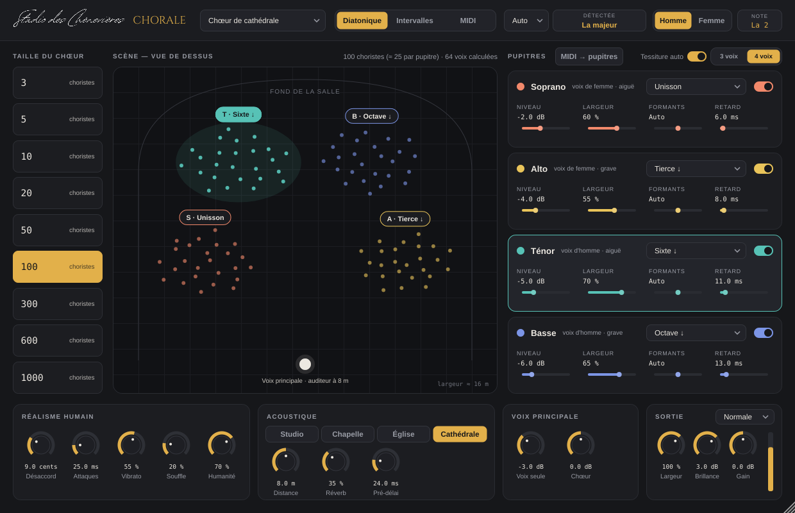

# Chènevières Chorale

Le chœur virtuel du **Studio des Chènevières** : on pose le plugin sur une voix, il en fait un chœur de **3 à 1000 choristes**.

## Ce que fait le plugin

- **Taille du chœur** : 3, 5, 10, 20, 50, 100, 300, 600 ou 1000 choristes.
- **3 ou 4 pupitres** (soprano, alto, ténor, basse), chacun avec son intervalle : unisson, seconde, tierce, quarte, quinte, sixte, septième, octave, au-dessus ou au-dessous, et quelques intervalles graves (dixième, octave + quinte, deux octaves).
- **Trois façons de choisir les notes** :
  - *Diatonique* (par défaut) : on indique la tonalité ; les tierces, sixtes… restent dans la gamme.
  - *Intervalles* : toujours le même nombre de demi-tons.
  - *MIDI* : les pupitres chantent les notes des accords joués au clavier (le dernier accord reste tenu).
- **Timbre SATB** : les formants sont déplacés pour qu'une voix d'homme donne des sopranos crédibles (et inversement). Indiquer si la voix d'origine est une voix d'homme ou de femme.
- **Tessiture automatique** : chaque pupitre est ramené dans son registre.
- **Scène vue de dessus** : on déplace chaque pupitre à la souris (double-clic : retour à sa place). La place change le panoramique, la distance, le timbre (l'air atténue les aigus) et le moment où le son arrive.
- **Réalisme humain** : désaccord, dispersion des attaques, vibrato propre à chacun (il s'installe au cours de la note), souffle, humanité (dérive de justesse, timbre et niveau propres à chaque choriste, glissés plus ou moins rapides).
- **Acoustique** : Studio, Chapelle, Église, Cathédrale ; distance, réverbération, pré-délai.
- **Voix principale** : dosage entre la voix d'origine et le chœur (tout à gauche : voix coupée).
- **Qualité** : Éco, Normale, Haute = 8, 16 ou 32 choristes réellement calculés par pupitre. Au-delà, une « masse » de copies décorrélées épaissit le pupitre.
- **12 préréglages** : cathédrale, chœur de chambre, gospel, chœur d'hommes, de femmes, moines, unisson massif, accords MIDI…

## MIDI → pupitres (avec ACE Studio)

Pour des choristes au timbre de vrais chanteurs :
1. Dans ACE Studio, **Vocal To MIDI** sur la voix sèche (notes et paroles), puis exporter le MIDI.
2. Dans Chènevières Chorale, régler les pupitres (intervalles, 3 ou 4 voix, tonalité ou Auto), puis cliquer
   **MIDI → pupitres** (ou glisser le fichier .mid sur la fenêtre).
3. Le plugin écrit à côté du fichier : `nom - Pupitres.mid` (toutes les pistes) et un fichier par pupitre,
   harmonisés, **paroles comprises**.
4. Les réimporter dans ACE Studio et faire chanter chaque pupitre en **mode Chœur** avec plusieurs voix.

## Conseils

- Le plugin aime une voix **sèche, juste et sans effet** (pas de réverbération ni de délai avant lui).
- **Latence** : environ 60 ms, annoncée au logiciel (compensée automatiquement). Pour chanter en direct dans le casque, écouter la voix sans le plugin.
- En mode MIDI, envoyer le clavier vers la piste de la voix (entrée MIDI du plugin).

## Installer

Les installateurs sont produits automatiquement par GitHub Actions à chaque envoi de code :
onglet **Actions** → dernier run vert → **Artifacts** :

- Windows : `Chenevieres-Chorale-x.y.z-Windows.exe` (VST3, AAX)
- macOS : `Chenevieres-Chorale-x.y.z-macOS.pkg` (VST3, Audio Unit, AAX).
  Tant que la signature Apple n'est pas branchée sur ce dépôt : après l'installation, `sudo xattr -cr` sur chaque plugin.

## Pour les développeurs

Voir [NOTES-DEV.md](NOTES-DEV.md).
